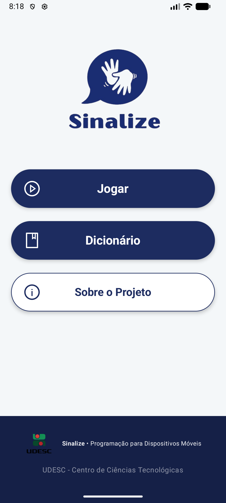
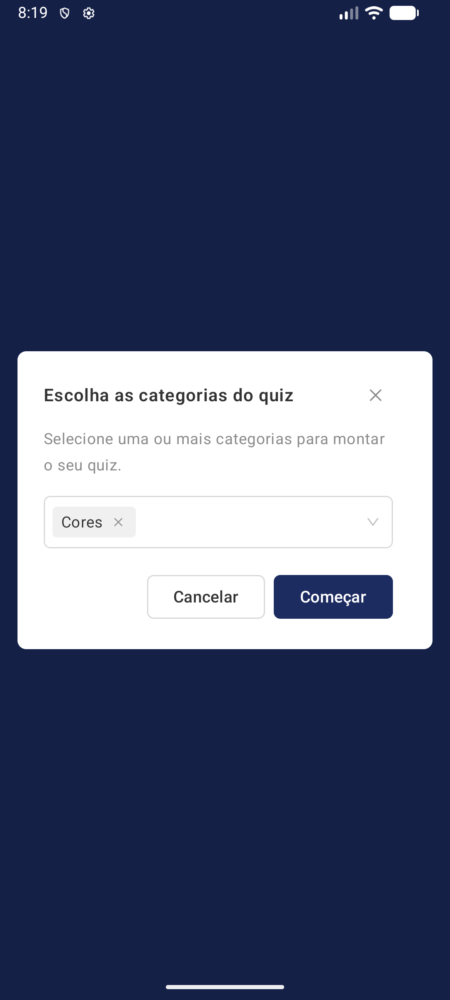
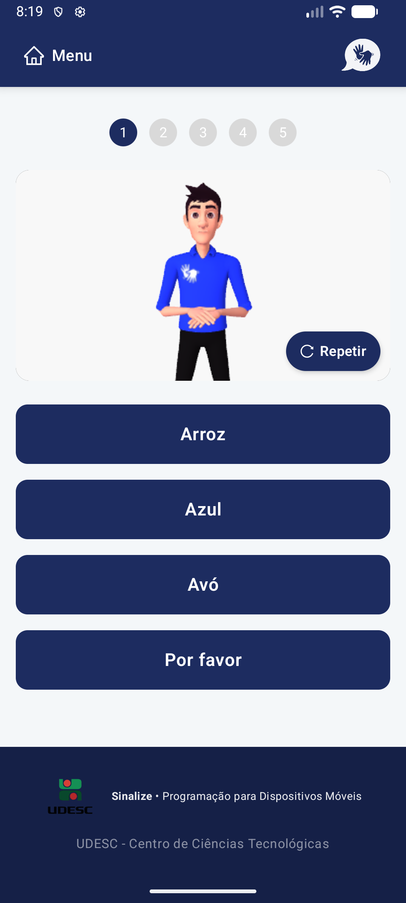
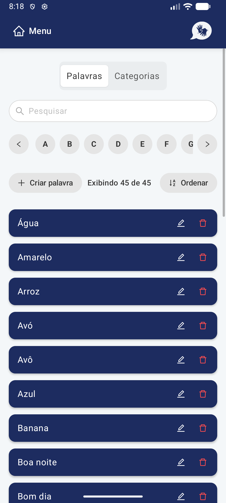

# Sinalize Mobile

<p align="center">
  
  <a href="https://developer.android.com/" target="blank"></a>
  <a href="https://spring.io/projects/spring-boot" target="blank"></a>
</p>

O **Sinalize Mobile** é a versão para Android do **Sinalize**, um quiz interativo e acessível voltado para o aprendizado da Língua Brasileira de Sinais (Libras). Um avatar 3D do **VLibras** sinaliza uma palavra e o jogador escolhe, entre quatro alternativas, qual palavra foi sinalizada.

O projeto nasceu na disciplina de Informática na Educação com um front-end em React e um back-end em NestJS, e foi trazido para o mobile na disciplina de **Programação para Dispositivos Móveis**. Este repositório reúne as duas partes:

- **App Android** (`android/`): construído com **Kotlin** e **Jetpack Compose**, reproduz o visual da versão web (mesmas telas, cores e ícones) e se adapta a celulares e tablets, em pé ou deitados.
- **Back-end** (`backend/`): uma API REST em **Spring Boot** com arquitetura em camadas (Controllers, Services e Repositories) e persistência no **PostgreSQL**, com o banco versionado pelo **Flyway**.

---

## Autores

Pedro Paoli Neto

Luís Felipe dos Anjos de Carvalho

Isadora Pimenta de Oliveira

Larissa Colzani

Vitória Carolina Devigili

---

## Tecnologias

**App Android**

- [**Kotlin**](https://kotlinlang.org/)
- [**Jetpack Compose**](https://developer.android.com/compose) com [**Material 3**](https://m3.material.io/)
- [**Navigation Compose**](https://developer.android.com/guide/navigation/navigation-compose) e **ViewModel** (arquitetura MVVM)
- [**Retrofit**](https://square.github.io/retrofit/), [**OkHttp**](https://square.github.io/okhttp/) e [**kotlinx.serialization**](https://github.com/Kotlin/kotlinx.serialization)
- [**VLibras**](https://www.gov.br/governodigital/pt-br/acessibilidade-e-usuario/vlibras), exibido em uma `WebView`

**Back-end**

- [**Java 21**](https://openjdk.org/projects/jdk/21/)
- [**Spring Boot 3.5**](https://spring.io/projects/spring-boot) (Spring Web, Spring Data JPA e Bean Validation)
- [**PostgreSQL 16**](https://www.postgresql.org/) rodando no [**Docker**](https://www.docker.com/)
- [**Flyway**](https://flywaydb.org/) para as migrations

---

## Funcionalidades

- **Página Inicial:** Tela de entrada com o acesso ao quiz, ao dicionário e às informações sobre o projeto.
- **Quiz:** O usuário escolhe uma ou mais categorias, assiste ao sinal executado pelo avatar 3D do VLibras e escolhe entre quatro alternativas. A resposta fica verde ou vermelha, o progresso aparece no topo e, ao final, é exibido o resultado. O botão **Repetir** faz o avatar sinalizar a palavra de novo.
- **Dicionário:** Gerenciamento das **palavras** e **categorias**, com busca, filtro por letra, ordenação e cadastro, edição e exclusão.

<p align="center">
  
  
  
  
</p>

O layout acompanha o tamanho da tela, seguindo os mesmos pontos de quebra da versão web: o dicionário mostra de 1 a 4 cards por linha e as alternativas do quiz passam para duas colunas em telas mais largas. Com o celular deitado, a página inicial coloca o logo ao lado dos botões.

---

## Integração com o VLibras

A sinalização é isolada em uma página HTML (`android/app/src/main/assets/vlibras-frame.html`) que carrega o plugin oficial do VLibras dentro de uma `WebView`. A classe `MotorVLibras` faz a ponte entre o app e essa página:

- A página avisa o app quando o avatar 3D está pronto (`AndroidBridge.onReady()`).
- O app envia a palavra a ser sinalizada (`window.sinalizar("...")`) e pode pedir para repeti-la (`window.repetir()`).

Como o avatar leva alguns segundos para carregar, ele começa a ser carregado assim que o app abre, ainda na página inicial. Quando a pessoa entra no quiz, o avatar normalmente já está pronto; se não estiver, o quiz espera por ele antes de mostrar a primeira pergunta. A página também esconde a legenda do VLibras, que mostraria a palavra e entregaria a resposta.

> O plugin do VLibras mudou de versão desde o projeto web (ele agora é aberto por `window.VLibrasWidget.open()`), e a página do app já está adaptada a isso.

---

## Modelo de Dados

A estrutura relacional segue a do projeto original, com regras de integridade referencial entre as seguintes entidades:

* **Usuarios:** Gerencia os dados do usuário que acessa o projeto. Por enquanto não há login, então todas as operações são feitas em nome de um usuário padrão.
* **Categorias:** Agrupam palavras de mesmo escopo/contexto (Saudações, Família, Cores...).
* **Palavras:** Palavras para uso no quiz. Cada palavra pertence a pelo menos uma categoria.
* **Quizzes:** Histórico de jogos realizados pelos usuários.
* **Quiz_Palavras:** Tabela associativa do histórico do quiz contendo **atributos próprios** (`acertou` e `respondido_em`) para registrar o desempenho de cada palavra respondida pelo usuário.

O banco é criado pelo Flyway a partir de três migrations: `V1` (tabelas), `V2` (dados iniciais: 6 categorias e 44 palavras) e `V3` (nomes únicos para palavras e categorias).

---

## Estrutura do Projeto

O repositório é dividido entre o app e a API. No app, cada tela tem a sua pasta, com a interface (Compose) e o seu `ViewModel`; a comunicação com a API fica na camada `data`. No back-end, a organização segue a separação em camadas do Spring.

```text
sinalize-mobile/
├── android/                          # App Android (abrir esta pasta no Android Studio)
│   └── app/src/main/
│       ├── assets/vlibras-frame.html # Página que hospeda o avatar do VLibras
│       └── java/br/com/sinalize/
│           ├── data/
│           │   ├── model/            # Modelos usados pelas telas
│           │   ├── remote/           # Retrofit: rotas da API, JSON e tratamento de erros
│           │   ├── repository/       # Interfaces de acesso aos dados
│           │   └── fake/             # Dados de exemplo em memória
│           ├── di/                   # AppContainer (injeção de dependências)
│           ├── ui/
│           │   ├── home/             # Página inicial e "Sobre o Projeto"
│           │   ├── quiz/             # Quiz, avatar e resultado
│           │   ├── dicionario/       # Dicionário de palavras e categorias
│           │   ├── components/       # Header, rodapé, botões e regras de responsividade
│           │   └── theme/            # Cores e tema
│           └── vlibras/              # MotorVLibras (WebView do avatar)
├── backend/                          # API REST em Spring Boot
│   ├── requests.http                 # Requisições prontas para testar a API
│   └── src/main/
│       ├── java/br/com/sinalize/api/
│       │   ├── controller/
│       │   ├── service/
│       │   ├── repository/
│       │   ├── entity/
│       │   ├── dto/
│       │   └── exception/
│       └── resources/
│           ├── application.yml
│           └── db/migration/         # Migrations do Flyway
├── docker-compose.yml                # PostgreSQL para desenvolvimento
└── README_imgs/                      # Imagens deste README
```

---

## Como Configurar e Rodar o Projeto

Siga as instruções abaixo para configurar o ambiente de desenvolvimento localmente. Os comandos são para o PowerShell, a partir da raiz do repositório.

### 1. Pré-requisitos

Antes de começar, certifique-se de ter instalado em sua máquina:

* [JDK 21](https://adoptium.net/) (não é preciso instalar o Maven, o projeto já traz o Maven Wrapper)
* [Docker](https://www.docker.com/) e Docker Compose
* [Android Studio](https://developer.android.com/studio) com um emulador (Android 8.0 ou superior)

> 💡 O Maven usa o JDK apontado pela variável `JAVA_HOME`. Se ela estiver apontando para o Java que vem com o Android Studio, ajuste-a para o JDK 21 antes de rodar a API: `$env:JAVA_HOME = "C:\caminho\do\jdk-21"`.

### 2. Clonar o Repositório

```bash
$ git clone https://github.com/paoli2004/sinalize-mobile.git
$ cd sinalize-mobile
```

### 3. Inicializar o Banco de Dados (Docker)

A API utiliza um banco PostgreSQL rodando de forma isolada em um container Docker. Para criá-lo e inicializá-lo, execute:

```bash
# Inicializar o container do Postgres em segundo plano
$ docker compose up -d
```

O banco fica disponível na porta **5433** (banco, usuário e senha: `sinalize`). Não é preciso rodar as migrations manualmente: o Flyway cria as tabelas e carrega os dados iniciais na primeira vez que a API sobe.

```bash
# 💡 Dica: para apagar o banco e começar do zero (o Flyway recria tudo na próxima subida da API)
$ docker compose down -v
$ docker compose up -d
```

### 4. Iniciar a API

```bash
$ cd backend
$ .\mvnw.cmd spring-boot:run
```

A API estará ativa na porta **http://localhost:8080**. Para conferir se ela está no ar, acesse `http://localhost:8080/actuator/health`, que deve responder `{"status":"UP"}`.

### 5. Rodar o App

1. Abra a pasta **`android/`** no Android Studio (não a raiz do repositório) e espere o *Gradle Sync* terminar.
2. Ligue um emulador pelo *Device Manager* e espere ele chegar à tela inicial do Android.
3. Selecione a configuração **`app`** e clique em **▶ Run**.
4. Na primeira vez que o app abrir, toque em **Permitir** quando o Android perguntar se o Sinalize pode se conectar a dispositivos próximos.

Também é possível instalar o app pelo terminal, dentro da pasta `android/`:

```bash
$ .\gradlew.bat installDebug
```

> 💡 **Por que o app pede essa permissão?** A partir do Android 17, um app só consegue acessar endereços da rede local (como a API rodando no seu computador) se o usuário permitir. Essa permissão e o acesso por `http://` existem apenas na versão de desenvolvimento do app.

#### Configurações opcionais

Por padrão, o app procura a API em `http://10.0.2.2:8080/`, que é o endereço do seu computador visto de dentro do emulador. Duas opções podem ser passadas na compilação (com `-P` no terminal ou no arquivo `android/gradle.properties`):

* **`sinalizeApiUrl`**: muda o endereço da API. Para usar um **celular físico**, informe o IP do computador na rede Wi-Fi, por exemplo `.\gradlew.bat installDebug -PsinalizeApiUrl=http://192.168.0.10:8080/`.
* **`sinalizeDadosIlustrativos`**: com o valor `true`, o app usa dados de exemplo em memória e funciona **sem o back-end**, o que é útil para mostrar as telas rapidamente.

#### Problemas comuns

* **"Não foi possível conectar ao servidor":** verifique se a API está no ar e se a permissão de dispositivos próximos foi concedida (*Configurações → Apps → Sinalize → Permissões*). Em celular físico, confira o IP informado e se o Firewall do Windows libera a porta 8080.
* **O avatar não aparece:** o VLibras precisa de internet. No emulador, o primeiro carregamento pode levar de 20 a 60 segundos; em celulares de verdade é bem mais rápido.
* **Mensagem em vermelho ao salvar no dicionário:** é uma regra da API, como uma palavra ou categoria com nome repetido. O app mostra a mensagem enviada pelo back-end.

---

## API REST

A API segue o padrão REST e usa JSON com os nomes de campo em `snake_case`, como no projeto original. O arquivo `backend/requests.http` traz requisições prontas para testá-la pelo IntelliJ ou pela extensão REST Client do VS Code.

* **Categorias:** `GET /categorias`, `GET /categorias/{id}`, `POST /categorias`, `PATCH /categorias/{id}` e `DELETE /categorias/{id}`.
* **Palavras:** `GET /palavras`, `GET /palavras/{id}`, `POST /palavras`, `PATCH /palavras/{id}`, `DELETE /palavras/{id}` e `GET /palavras/aleatorias?excluir=1,2&quantidade=3`, usada para sortear as alternativas erradas do quiz.
* **Quizzes:** `POST /quizzes` (com `{"categoria_ids": [..]}`, sorteia até 5 palavras), `GET /quizzes`, `GET /quizzes/{id}` e `PATCH /quizzes/palavras/{id}/responder` (com `{"acertou": true}`).
* **Usuários:** `GET`, `POST`, `PATCH` e `DELETE` em `/usuarios`, com a senha gravada em hash BCrypt.

Todos os erros seguem o mesmo formato, com uma mensagem pronta para ser exibida ao usuário (e, em erros de validação, a mensagem de cada campo):

```json
{
  "timestamp": "2026-11-10T20:29:06.5433203-03:00",
  "status": 409,
  "error": "Conflict",
  "message": "Já existe uma palavra com esse nome.",
  "path": "/palavras"
}
```

Em relação à API original em NestJS, algumas regras foram ajustadas: palavras e categorias não podem se repetir, uma categoria com palavras não pode ser excluída, uma palavra já usada em quiz não pode ser apagada e cada item do quiz só pode ser respondido uma vez. Erros que antes resultavam em falhas internas (500) agora retornam mensagens claras.

---

## Testes

```bash
# Back-end: testes de unidade (controllers e services)
$ cd backend
$ .\mvnw.cmd test

# Back-end: testes de unidade + testes de integração com o PostgreSQL (precisa do Docker no ar)
$ .\mvnw.cmd verify

# App Android: testes de unidade (filtros, quiz, responsividade e comunicação com a API)
$ cd android
$ .\gradlew.bat testDebugUnitTest
```

Os testes de integração do back-end usam um schema separado no banco (`it`), então os dados de desenvolvimento não são alterados.

---

## Repositórios do projeto

Repositório Sinalize Mobile (Android + Spring Boot) (Este!)

[Repositório Front-end original (React)](https://github.com/joaosell/sinalize)

[Repositório Back-end original (NestJS)](https://github.com/paoli2004/sinalize-back)
